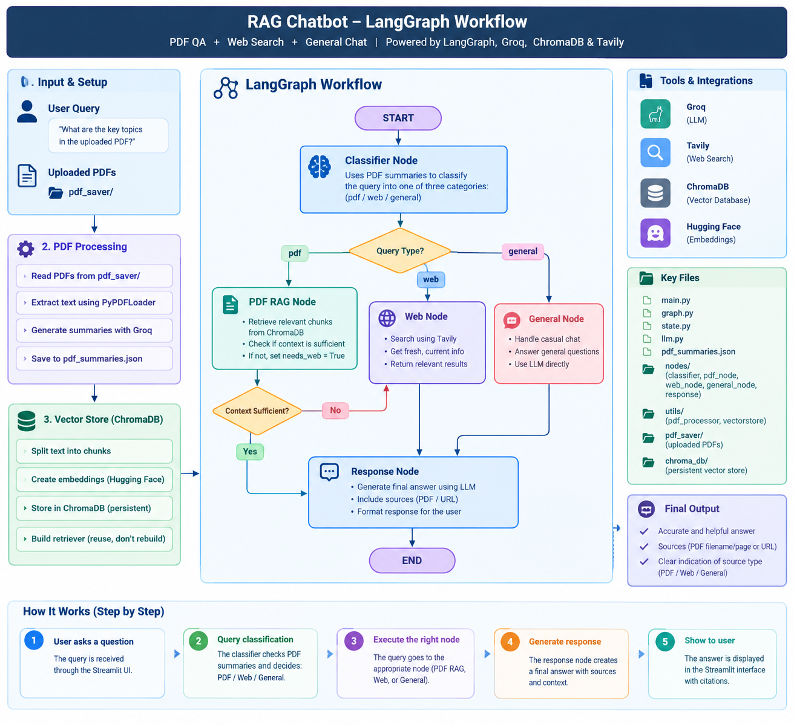

# 📚 AI PDF Chatbot (LangGraph RAG)

An agentic RAG chatbot that answers questions from your uploaded PDFs, falls back to live web search when the documents aren't enough, and handles general conversation, all routed automatically by a LangGraph workflow.

Built with **LangGraph, Groq, ChromaDB, Hugging Face embeddings, Tavily and Streamlit**.

## ✨ Features

- **Chat with multiple PDFs.** Upload and manage documents from the Streamlit sidebar.
- **Smart query routing.** An LLM classifier uses auto-generated PDF summaries to choose between PDF retrieval, web search and general chat.
- **Automatic web fallback.** If the retrieved PDF context isn't sufficient, the graph searches the web with Tavily instead of guessing.
- **Conversation memory.** Follow-up questions such as "explain that more" are rewritten into standalone queries using chat history before retrieval.
- **Incremental indexing.** PDFs are chunked and embedded once. New uploads are added and deleted files are removed, with no duplicate chunks.
- **Cached summaries.** Each PDF is summarized once and stored in `pdf_summaries.json`.

## 🧭 Architecture



> The diagram shows the core routing. In the code, a **rewrite** node runs before the classifier to turn follow-up questions into standalone queries.

**Flow**

1. **Rewrite**: resolves references in follow-up questions using recent chat history.
2. **Classifier**: compares the query against the PDF summaries and picks `pdf`, `web` or `general`.
3. **PDF RAG**: retrieves the top chunks from ChromaDB and checks whether they are sufficient to answer.
4. **Web**: runs a Tavily search (used directly for `web` queries, or as a fallback when PDF context is insufficient).
5. **General**: skips retrieval and answers with the LLM alone.
6. **Response**: generates the final answer from the PDF context, web results or general knowledge, and keeps the two sources distinct.

## 🛠️ Tech Stack

| Component | Technology |
|---|---|
| Orchestration | LangGraph |
| LLM | Groq (`openai/gpt-oss-20b`) |
| Embeddings | `sentence-transformers/all-MiniLM-L6-v2` |
| Vector store | ChromaDB |
| Web search | Tavily |
| PDF parsing | PyPDF |
| UI | Streamlit |

## 📁 Project Structure

```
Rag_chatbot/
├── main.py                 # Streamlit app (chat + PDF upload)
├── graph.py                # LangGraph workflow and routing
├── state.py                # Shared graph state
├── llm.py                  # Groq LLM setup
├── pdf_summaries.json      # Cached PDF summaries (auto-generated)
├── nodes/
│   ├── rewrite_node.py     # Follow-up → standalone query
│   ├── classifier.py       # pdf / web / general routing
│   ├── pdf_node.py         # Retrieval + sufficiency check
│   ├── web_node.py         # Tavily web search
│   ├── general_node.py     # No-retrieval path
│   └── response.py         # Final answer generation
├── utils/
│   ├── pdf_processor.py    # PDF summarization
│   ├── vectorstore.py      # Chroma indexing and retriever
│   └── history.py          # Chat history formatting
├── pdf_saver/              # Uploaded PDFs
└── chroma_db/              # Persistent vector store
```

## 🚀 Getting Started

### 1. Clone and install

```bash
git clone <your-repo-url>
cd Rag_chatbot
python -m venv venv
source venv/bin/activate        # Windows: venv\Scripts\activate
pip install -r requirements.txt
```

### 2. Add your API keys

Create a `.env` file in the project root:

```env
GROQ_API_KEY=your_groq_api_key
TAVILY_API_KEY=your_tavily_api_key
```

- Groq key: https://console.groq.com
- Tavily key: https://tavily.com

### 3. Run the app

```bash
streamlit run main.py
```

Upload PDFs from the sidebar, click **Process PDFs**, and start asking questions.

## 💬 Example Queries

| Query | Route |
|---|---|
| "What are the key topics in the uploaded PDF?" | PDF |
| "Explain that in more detail" (follow-up) | PDF, after rewrite |
| "What's the latest news on AI regulation?" | Web |
| "Write a Python function to reverse a string" | General |
| A PDF question the document can't fully answer | PDF → web fallback |

## ⚠️ Limitations

- Scanned PDFs without a text layer aren't supported (no OCR yet).
- Conversation memory lasts for the Streamlit session and is cleared with **Clear Chat**.
- Routing and the sufficiency check rely on a small LLM and may occasionally misclassify.

## 🗺️ Roadmap

- [ ] Show source citations (file, page, URL) under each answer in the UI
- [ ] Hybrid search (BM25 + vector) and cross-encoder reranking
- [ ] Evaluation set with routing accuracy and retrieval hit-rate metrics
- [ ] Streaming responses
- [ ] OCR support for scanned PDFs
- [ ] Docker and cloud deployment

